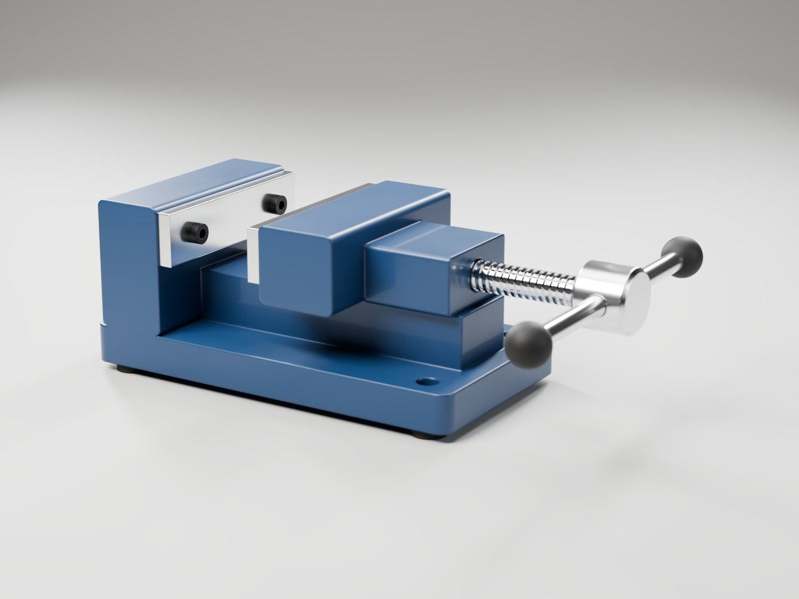
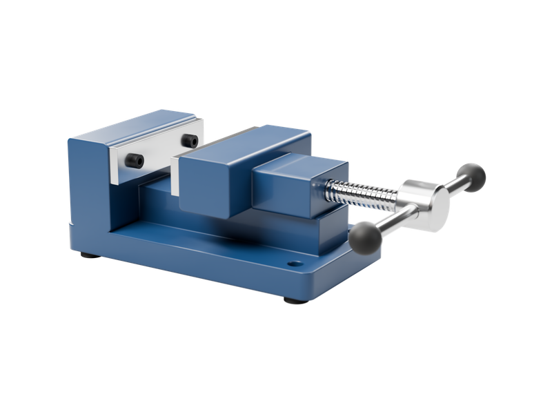
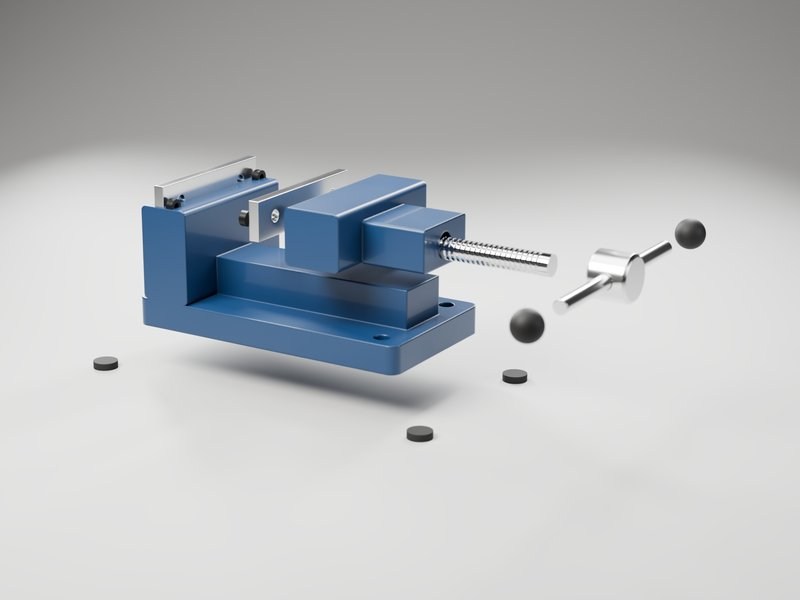
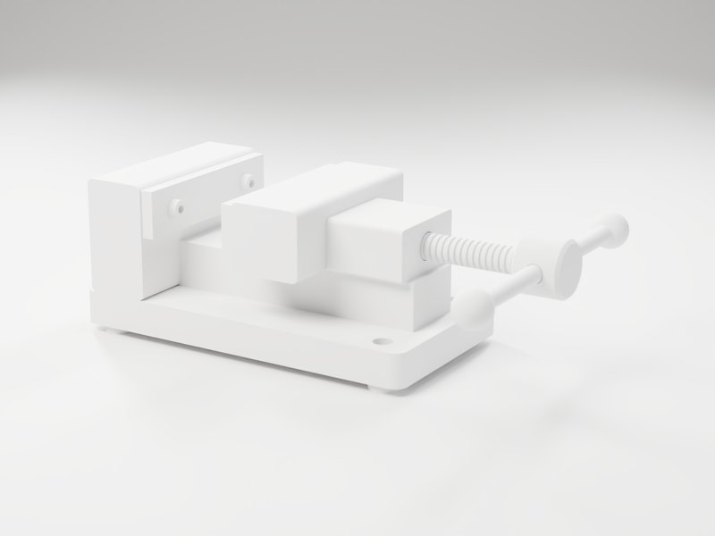

# cad-studio-renders

Turn a CAD file into product photography, transparent cut-outs and a self-hosted 3D viewer. It's
one command and runs entirely on your machine.



| Transparent cut-out | Exploded view | Clay pass |
|---|---|---|
|  |  |  |

Every image above came from `examples/demo-vise.step` with no hand editing. The demo vise is
original geometry built by `examples/make_demo_model.py`.

## What it makes

From one STEP / IGES / BREP / GLB file:

- **Studio shots:** photoreal, 16-bit PNG on a seamless backdrop. Real studio HDRI, softbox rig,
  rounded edges, surface texture, depth of field.
- **Transparent cut-outs:** RGBA PNGs that keep a soft contact shadow, ready to drop on any
  background.
- **A self-hosted 3D embed:** a static folder with the web model (Draco), iPhone AR (USDZ), a
  poster image and a demo page. It makes zero external requests. Paste two tags into any site, or
  iframe it.
- **For 3D artists:**
  - an editable `.blend` with cameras on timeline markers, one empty per part and clean node
    materials
  - a multilayer EXR with depth, normals, AO, mist and Cryptomatte (object and material)
  - a clay pass, an exploded view, and a 360° turntable as MP4, WebM (alpha optional) and frames
- **Material map:** every part's finish and the reason it was chosen, overridable with a small
  rules file.

## Quick start

```bash
# needs Blender 4.2+, uv, and ffmpeg (for turntables)
git clone https://github.com/<owner>/cad-studio-renders
cd cad-studio-renders

python3 scripts/studio.py examples/demo-vise.step --map-only   # check materials
python3 scripts/studio.py examples/demo-vise.step --preview    # 10-second draft
python3 scripts/studio.py examples/demo-vise.step --name "Bench Vise" \
        --shots hero,front,iso --clay --passes --exploded 0.45 --turntable
```

The output goes to `examples/demo-vise_studio/`. On the first run, the CAD reader (~60 MB) and
a CC0 studio HDRI (24 MB) download into `~/.cache/cad-studio-renders/`.

## Use it as an agent skill

`SKILL.md` follows the open Agent Skills format. To use it with Claude Code:

```bash
git clone https://github.com/<owner>/cad-studio-renders ~/.claude/skills/cad-studio-renders
```

Then ask: *"render model.step as studio shots with a transparent version and a web embed"*.
Other agents that read `SKILL.md` folders work the same way.

## Fixing materials

CAD files rarely say what anything is made of. The mapper guesses from part names (fasteners,
bearings, rails, motors, rubber, glass...), then from CAD colours, then from size, and flags
pure guesses with `(review me)`. Override any part with a rules file:

```json
{"rules": [
  {"match": "frame|base",   "preset": "powder_coat", "color": "#2b2f33"},
  {"match": "cover",        "preset": "plastic_textured"},
  {"match": "spindle",      "preset": "steel_polished", "params": {"roughness": 0.05}},
  {"match": "guard",        "hide": true},
  {"match": "Coupling#0",   "preset": "plastic_color", "color": "#c22a12"}
]}
```

```bash
python3 scripts/studio.py model.step --rules rules.json
```

There are 24 presets in `assets/presets/materials.json`: powder coat, anodised, machined, bead
blast, ground steel, chrome, brass, rubber, textured plastic, glass and more. Lighting rigs
(`studio_soft`, `high_key`, `dramatic`, `hdri_only`) are in `lighting.json`, and camera
angles in `shots.json`. Edit those files or add your own.

## Self-hosting the 3D viewer

Upload `<model>_studio/embed/` to any static host and paste the contents of `snippet.html`:

```html
<script type="module" src="https://your-site.com/3d/bench-vise/vendor/model-viewer.min.js"></script>
<model-viewer src="https://your-site.com/3d/bench-vise/assets/bench-vise.glb"
              ios-src="https://your-site.com/3d/bench-vise/assets/bench-vise.usdz"
              camera-controls auto-rotate ar ...></model-viewer>
```

`embed/README.md` has notes for WordPress, Shopify, Webflow and Squarespace.

## Requirements

| Tool | Why | Install |
|---|---|---|
| Blender 4.2+ | rendering, scene, web export | https://www.blender.org/download/ |
| uv | runs the CAD reader (OpenCascade) in its own environment | https://docs.astral.sh/uv/ |
| ffmpeg | turntable MP4/WebM (optional) | your package manager |

A GPU (Apple Silicon, NVIDIA, AMD) makes renders 5-20x faster. On an M1 Max a 2400 px hero at
256 samples takes about 2 minutes, and the transparent version about 3.

## How it works

1. `cad_to_glb.py` reads the assembly with OpenCascade. It keeps part names, instances and CAD
   colours, tessellates relative to model size, and detects the up axis from the program that
   wrote the file.
2. `automap.py` decides a material for every part, and every decision comes with a reason.
3. `blender_studio.py` builds the scene and renders. It scales the backdrop sweep, the light rig
   and the HDRI to the model and keeps them in the same place relative to each camera. Cameras
   frame with lens shift, so verticals stay vertical.
4. `package_embed.py` writes the static viewer: Google `<model-viewer>` plus the Draco decoder,
   both vendored.

## Credits and licences

- Code: MIT (see `LICENSE`).
- Studio HDRIs: [Poly Haven](https://polyhaven.com), CC0. They're downloaded on demand and not
  stored in this repo.
- Embed package: [`<model-viewer>`](https://github.com/google/model-viewer) (Apache-2.0) and the
  Draco decoder (Apache-2.0), downloaded from npm at build time. Their licences are copied into
  every package.
- Demo model: original, CC0.
